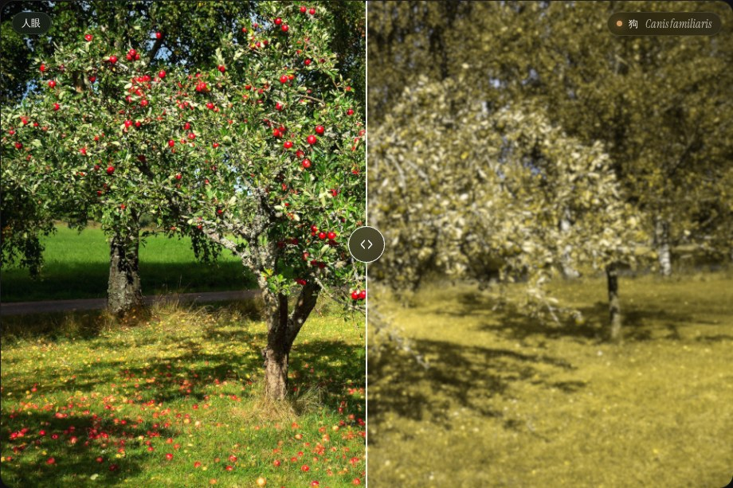
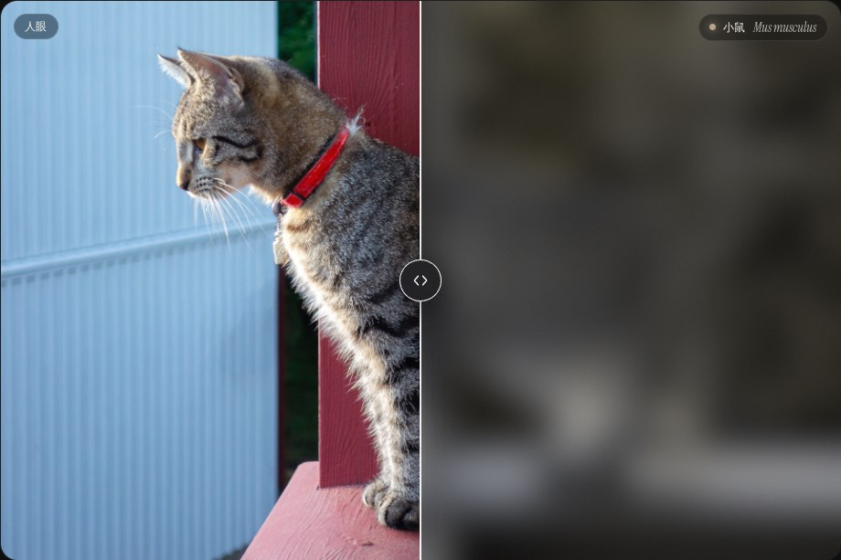

# Animal Vision · 动物之眼

**One world, six eyes.** Drag the line to compare how a human, a dog, a cat, a honeybee, an eagle and a mouse see the same photo, or drop in your own.

[中文](README.md) · **Live: <https://ttnan.github.io/animal-vision/>**


## What it does

- **Drag to compare**: human on the left, animal on the right, the line wherever you like.
- **Six eyes**: human, dog, cat, honeybee, eagle, mouse, each with its own colour vision, sharpness and low-light ability.
- **Light**: as shot / dusk / night. As it gets dark we lose colour and then drown in noise, while cats and dogs still see.
- **All six**: every eye side by side on one photo.
- **Your photo**: drop, paste or choose. It's processed on your GPU in the browser and never uploaded.
- **Save image**: export a labelled comparison to share.
- **Six 4K samples** (CC0): orchard, sunflower, valley, market, night street, cat, each with a suggested eye.

| Dog: red apples vanish into leaves | Bee: false colour and facets |
|---|---|
|  |  |
| **Cat: a street at night** | **Eagle: loupe on distant peaks** |
|  |  |
| **Mouse: a cat as a soft blur** | **All six** |
|  |  |

## How the images are made

| | Colour | Sharpness (min. angle of resolution) | Low-light gain |
|---|---|---|---|
| Human | Trichromat 420 / 530 / 560 nm | 1′ (20/20) | 1× |
| Dog | Dichromat 429 / 555 nm | 3.75′ (≈20/75) | ≈3.5× |
| Cat | Dichromat 450 / 555 nm, low saturation | ≈7′ (20/100–20/200) | ≈6× |
| Honeybee | UV 344 / blue 436 / green 544 nm, false colour | each facet ≈1–2° | 0.8× |
| Eagle | Tetrachromat, oil droplets | ≈0.35′ (20/5) | 0.8× |
| Mouse | UV 360 / green 508 nm | ≈60′ (0.5 cycles/°) | ≈4× |

- **Colour**: dogs and cats use the Machado, Oliveira & Fernandes (2009) dichromat model; mice lack a long-wave cone and use the protan model; bees use the usual false colour (green→red, blue→green, UV→blue).
- **Sharpness**: the CSS reference pixel spans about 1.28 arcmin at arm's length, close to the human limit, so one CSS pixel stands in for the finest detail we resolve. Other eyes get a Gaussian blur set by their own minimum angle of resolution. An eagle out-resolves the screen, so it gets a 3× loupe instead.
- **Dim light**: each eye brightens by its own gain; colour fades first (with a slight Purkinje shift) and noise creeps in.

**Limits**: photos carry no UV or heat, so the bee's UV channel is estimated from colour, and facets are drawn at half their real size. Field of view, motion and the brain's processing aren't drawn. These are grounded approximations, not what an animal actually experiences.

## Run locally

No build step, plain static files (ES modules + WebGL2):

```bash
python3 -m http.server 8080   # then open http://localhost:8080
```

Regenerate the README shots: `npm i && npm run capture` (needs Playwright's Chromium).

URL parameters: `?img=orchard|sunflower|valley|market|night|cat&eye=dog|cat|bee|eagle|mouse&light=day|dusk|night&view=grid&lang=zh|en`

## Photos

All from Wikimedia Commons, CC0:
[Orchard](https://commons.wikimedia.org/wiki/File:Tree_with_red_apples_in_Barkedal_1.jpg) W.carter ·
[Sunflower](https://commons.wikimedia.org/wiki/File:Sunflower_and_bees.jpg) Mustang Joe ·
[Valley](https://commons.wikimedia.org/wiki/File:Wet_mountain_valley_(Unsplash).jpg) Kalen Emsley ·
[Market](https://commons.wikimedia.org/wiki/File:Fruit_market_in_Genoa,_Italy_-_DSC01268.JPG) Daderot ·
[Night street](https://commons.wikimedia.org/wiki/File:Night_street_in_Udagawach%C5%8D,_Tokyo_(53335292514).jpg) Romain Guy ·
[Cat](https://commons.wikimedia.org/wiki/File:Young_tabby_cat_keeping_watch.jpg) W.carter

Fonts: Instrument Serif and Inter (SIL Open Font License).

The earlier 3D room version lives on at tag [`v4-3d`](https://github.com/TTNAN/animal-vision/tree/v4-3d).

MIT License
