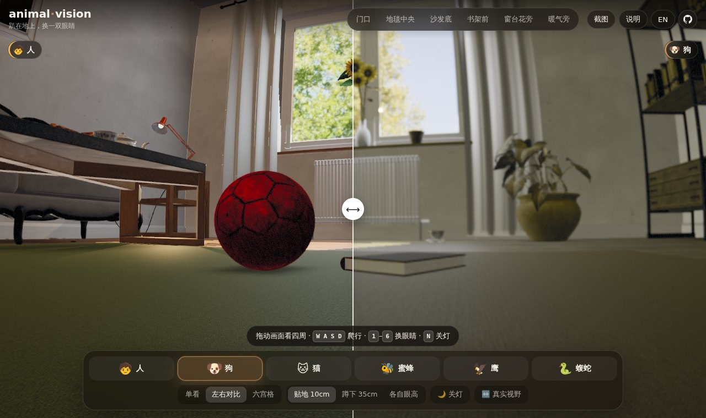
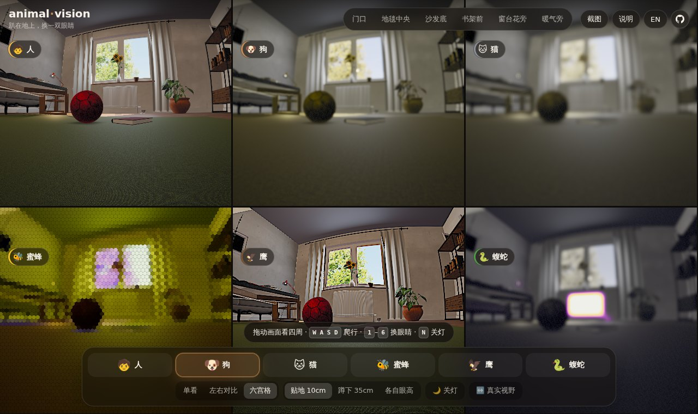
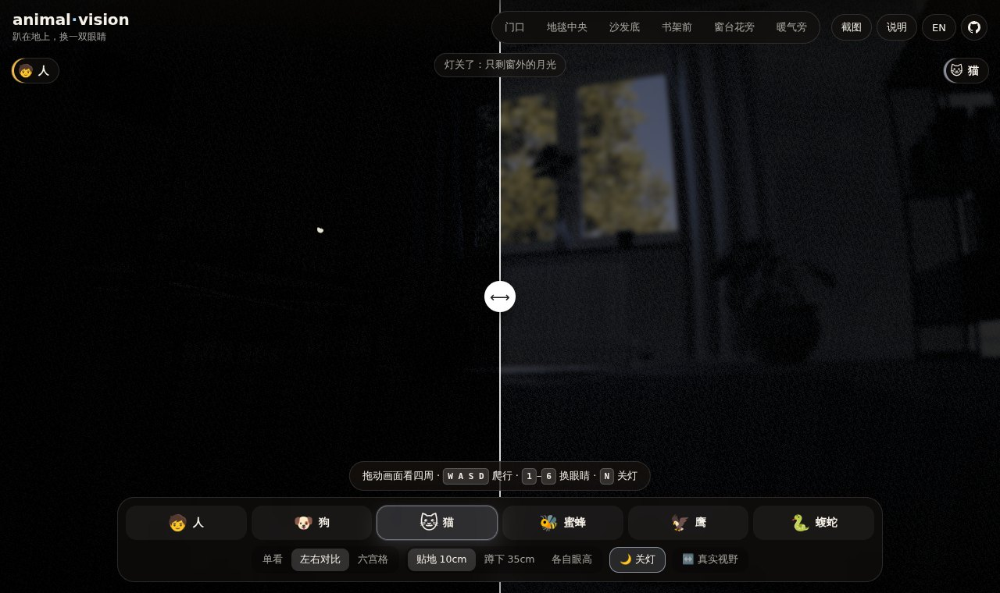
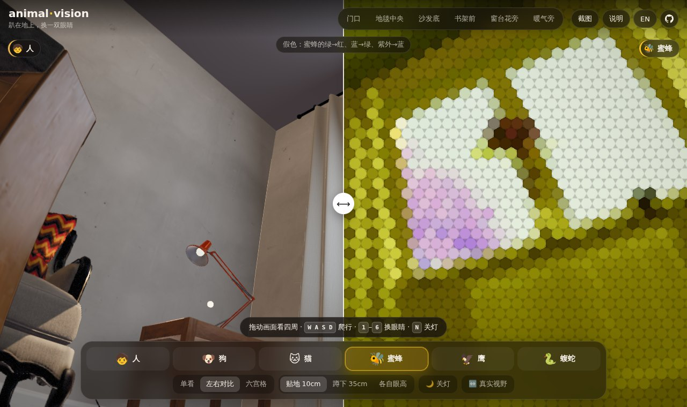
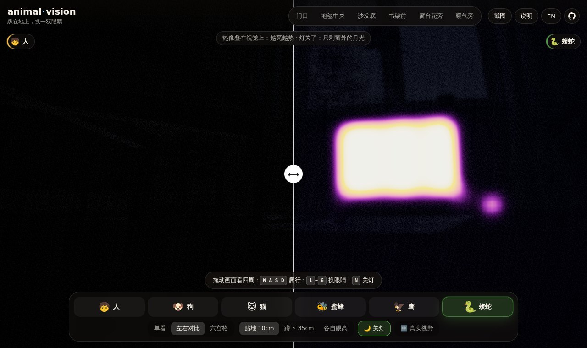

中文版: [README.md](README.md)

# animal-vision · Down on the floor, through other eyes

A lived-in 3D living room, Sunday 10:30 am: a linen throw left on the sofa, a book face-down by a cold cup of tea, the sun just reaching the rug. Most furniture and surfaces are photoscanned models and materials. The camera sits 10 cm off the floorboards, like a cat lying on them: you look up at the sofa, the old red ball on the green rug, the sunflowers on the window board. Then you swap eyes: dog, cat, honeybee, eagle, pit viper.



## Open it and play

```bash
git clone https://github.com/TTNAN/animal-vision.git
```

Live: `https://TTNAN.github.io/animal-vision/`.

To run locally you need a static server (models and textures load over HTTP, so double-clicking `index.html` won't work). The bundled `dist/app.js` is committed, so nothing to install:

```bash
cd animal-vision
python3 -m http.server 8000
# then open http://localhost:8000
```

The first load downloads about 27 MB of models and textures.

| Action | Desktop | Phone |
| --- | --- | --- |
| Look around | Drag | One-finger drag |
| Crawl | W A S D / arrow keys | Pad, bottom left |
| Switch eyes | 1–6 or the bottom bar | Bottom bar |
| Lights off | N | "Lights off" |
| Snapshot | "Snapshot" | Same |

## Six little quests

The About panel jumps straight to each one:

1. 🔴 **Where did the red ball go?** To a dog, the red leather ball on the olive wool rug is only a brightness difference, and the red book and green bottle merge.
2. 🌻 **The sunflower's UV bullseye.** To a bee, the petals are bright at the tips and dark at the centre, a runway to the nectar.
3. 👁 **Who can read the bottom of the eye chart?** All six at once; the eagle's fovea works like a telephoto lens.
4. 🍵 **Lights off: which tea is still hot?** We see black and two identical cups; the pit viper's heat pits light up the hot tea, the radiator and the lamp, while the cold cup stays dark.
5. 🌙 **Lights off: what does the cat see?** We see almost nothing; the cat still sees the room.
6. ↔️ **How wide can a view be?** Turn on True field and the bee's and dog's views open up.

Plus "peek out from under the sofa": set height to "Own height" and crawl under as the cat.



| Dog · rug | Cat · lights off |
| --- | --- |
|  |  |
| **Bee · window flowers** | **Pit viper · find the hot tea** |
|  |  |

## Six pairs of eyes

| Eyes | Colour | Acuity | Field | At night |
| --- | --- | --- | --- | --- |
| Human | Trichromat, ~420 / 530 / 560 nm | 20/20, the reference | ~200° | Reference |
| Dog | Dichromat, ~429 / 555 nm, red and green merge | ~20/75 | ~240–250° | Tapetum, better than us |
| Cat | Dichromat, ~450 / 555 nm, washed out | ~20/100–20/200 | ~200° | Needs ~1/6 of our light |
| Honeybee | UV / blue / green, blind to red; false colour | Each facet ~1.5–2° | Nearly 360° | Poor |
| Eagle | Tetrachromat, oil droplets saturate colour | ~20/5, magnified fovea | 200°+ | Worse than us |
| Pit viper | Dichromat eyes + heat-sensing pits | Blurry heat image | ~170° (illustrative) | Heat needs no light |

## Why these things are in the room

Each object exposes one difference:

- **An old red leather ball on an olive wool rug, a red cloth-bound book, a green glass bottle** (similar luminance): red–green discrimination.
- **Sunflowers and flowers on the sill**: carry a UV map; only the bee sees the bullseye.
- **A paper eye chart in a thin frame** leaning on the wall, and book spines: acuity.
- **Hot tea, cold tea, radiator, lamp, window glass**: every object has a temperature for the viper's heat view.
- **Doorway, middle of the rug, under the sofa, bookshelf, window flowers, radiator**: six camera spots, all places a cat would lie.
- Sofa, coffee table, lounge chair, sideboard, shelves, a plant, pictures: so it reads as a real, lived-in room first.

## The science: what this is not

This is an **approximation**. No screen can give you another animal's experience; it can translate published measurements into a picture we can read.

- **Dichromacy** (dog, cat, the viper's eyes) is simulated in linear light with dichromat matrices tuned to each species' cone peaks, preserving luminance.
- **Acuity** becomes a per-species blur radius; the eagle is sharpened and magnified at the centre to suggest the deep fovea.
- **Screens cannot show UV.** UV is a separate painted map in the scene (the bullseye shape is typical of such patterns, not measured data), and the bee view uses **false colour**: green→red, blue→green, UV→blue.
- **The bee's hex mosaic** shows the scale of compound-eye resolution; real ommatidia are not a regular grid.
- **Heat** is rendered from a temperature set on each object, then blurred; viper fields and resolution vary a lot by species, so this is illustrative.
- **Very wide fields** can only be squeezed onto a flat screen; True field caps at about 230°, beyond which it turns into a tiny-planet swirl.
- Night mode's colour loss, noise and gain are illustrative, not measured sensitivity curves per species.

If something disagrees with the literature, please open an issue, ideally with a source.

## Hacking on it

```bash
npm install
npm run dev      # rebuild on change and serve locally
npm run build    # writes dist/app.js
npm run capture  # regenerate the screenshots in assets/ (needs Chrome)
```

```text
animal-vision/
├── index.html          # page shell, Chinese first, EN toggle top right
├── style.css
├── dist/app.js         # bundled code (what index.html loads)
├── src/
│   ├── main.js         # rendering, movement, collision, split views, quests, URL params
│   ├── room.js         # room, furniture, props, lights, camera spots
│   ├── textures.js     # procedural textures (eye chart, UV petals, leaves…)
│   ├── vision.js       # per-species parameters and the shader
│   └── i18n.js         # Chinese/English copy and quests
├── tools/capture.mjs   # screenshot script
├── assets/models/      # scanned models (GLB)
├── assets/tex/         # PBR materials and the window panorama
└── assets/             # README images
```

**How it renders**: each frame, cube cameras at the eye position capture all directions (normal colour, UV and temperature), and a shader projects, blurs, recolours and adds mosaic or heat per species. One position feeds all six eyes, so split and grid views show the same instant.

**Share a view** with URL parameters, e.g. `index.html?sp=bee&view=flower&mode=split`: `sp` (human/dog/cat/bee/eagle/snake), `view` (door/rug/sofa/shelf/flower/radiator), `mode` (single/split/grid), `h` (toy/baby/own), `night=1`, `fov=1`, `lang=en`, `exposure=1.1`.

## Assets

Furniture, tea set, books, ball, floor, walls, fabrics and the outdoor panorama are from [Poly Haven](https://polyhaven.com), CC0. The window, radiator, sunflowers, eye chart and the throw on the sofa are built in code.

## Versions

- **v4**: the kid's room becomes a lived-in adult living room; ACES tone mapping, 4096 shadows, window sun on the floor, glass/wool/linen materials; red ball, sunflowers, eye chart and heat sources become adult objects.
- **v3**: scanned models, PBR materials and real daylight.
- **v2**: 3D kid's room, floor-height camera, six eyes (new: pit viper heat), split and grid views, lights off, true field, six quests, six camera spots.
- **v1**: one AI-generated living-room photo with five filters (commit `6f52ccd`).

MIT License
