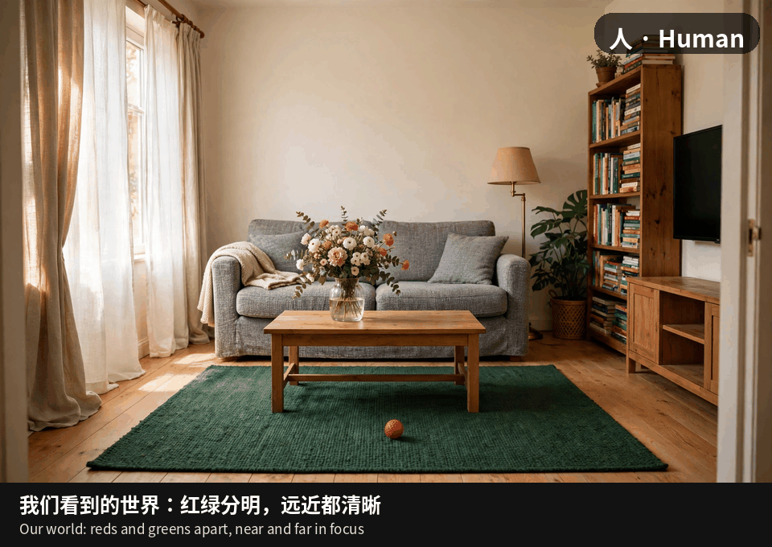

English version: [README.en.md](README.en.md)

# animal-vision · 同一间房，不同的眼睛

同一个家庭客厅，同一个固定视角——人、狗、猫、蜜蜂、鹰看到的，是五个世界。

这不是一张“换滤镜”的图。我们先搭了一间真实的客厅：沙发、茶几、电视柜、书架、落地灯、窗帘、绿地毯上的红色小球、茶几上的花瓶插花。然后让五种眼睛轮流看它，颜色和清晰度的差别，一眼就能看出来。



动图依次是：人 → 狗 → 猫 → 蜜蜂 → 鹰，每帧停留约 1.2 秒，循环播放。

## 30 秒看懂

- **红球去哪了？** 人眼里，红色小球在绿地毯上很显眼。狗眼里红和绿分不清了，球只剩明暗差别——所以狗找红球，靠的不是颜色，是亮度和动静。
- **花上多了什么？** 蜜蜂眼里，花心多了一圈紫外线“蜜导”图案，像给传粉者画的跑道。人眼完全看不见它。
- **书架有什么不一样？** 鹰眼里，远处一排排书脊更清晰；狗和猫眼里，同一个书架就是一片糊。

## 怎么用

什么都不用装，这是一个纯静态页面。

```bash
git clone https://github.com/TTNAN/animal-vision.git
cd animal-vision
```

然后双击打开 `index.html` 就行。没有构建步骤，没有依赖，不联网也能看。

想放到网上：推上 GitHub 后，在仓库的 Settings → Pages 里选择从 `main` 分支部署，地址一般是 `https://TTNAN.github.io/animal-vision/`。

## 五个视角，各一句话

| 视角 | 颜色 | 清晰度 | 一眼看什么 |
| --- | --- | --- | --- |
| 人 Human | 三色视觉，红、绿、蓝分明 | 参照标准，最清晰 | 红球很显眼，花就是花 |
| 狗 Dog | 二色视觉，视锥峰值约 429 与 555 nm，红绿变成黄灰 | 约 20/75，轻微模糊 | 红球只剩明暗差别，世界以蓝、黄为主 |
| 猫 Cat | 二色视觉，视锥峰值约 450 与 555 nm，颜色更淡 | 明显低于人眼，画面更糊 | 颜色淡了、糊了，但弱光下反而看得更清 |
| 蜜蜂 Bee | 三色视觉，但是是紫外线、蓝、绿——没有红色 | 与人眼接近，略柔和 | 红色消失了，花心出现紫外线蜜导图案 |
| 鹰 Eagle | 四色视觉，含紫外线 | 远高于人眼 | 远处书脊更清晰，细节一下子放大 |

## 房间里为什么放这些东西

每件东西都是为了让某一种差别露出来，不是随便摆的：

- **绿地毯上的红色小球（狗的玩具）**：测红绿之分。人眼红绿分明，狗眼红绿合一。
- **茶几上的花瓶插花**：测紫外线。蜜蜂靠花心的紫外线图案找花蜜，人眼什么也看不到。
- **右边的木书架，一排排颜色各异的书脊**：测清晰度。离得越远，狗、猫和鹰的差别越大。
- **灰色布艺沙发、木茶几、落地灯、窗帘、窗户、绿植、电视柜**：让房间先像一个真实的家，对比才有意义。没有实验室才会出现的东西。

## 科学说明——先说清楚这不是什么

这是一个**近似模拟**，不是“动物眼里原样复刻”。没有任何屏幕能让你真正体验另一种动物的主观感受，能做到的只是把已发表的测量结果翻译成人眼能看懂的样子：

- 狗和猫的二色视觉，用的是 Machado / Brettel 一类的二色模拟方法，按各自实测的视锥峰值换算（狗约 429 与 555 nm，猫约 450 与 555 nm），在整张图上统一换算，不是只给红球单独换色。
- 模糊按视力高低来：狗约 20/75，猫更低，鹰则做锐化。亮度在换算时做了守恒处理，避免换个颜色就把整个房间变暗、变黄，那会掩盖真正的颜色差别。
- **紫外线在普通屏幕上无法真实还原。** 屏幕发不出紫外线，普通照片里也没有紫外线信息。所以蜜蜂那一帧花心的蜜导图案是**示意**：真实花朵上的紫外线图案确实存在，形状和位置是按这类图案的常见形态画的，但它不是从照片里“还原”出来的。
- 同理，鹰的紫外线视觉也没有在图里单独画出来——它和人眼的差别主要体现在清晰度上，图里只呈现了这一点。

如果你发现哪里和文献对不上，欢迎提 issue 指正，附上来源就更好。

## 项目结构

```text
animal-vision/
├── index.html                 # 中文优先的展示页，右上角可切 EN
├── README.md                  # 中文版（本文件，GitHub 首页）
├── README.en.md               # 英文版
├── assets/
│   ├── demo.gif               # 五个视角循环对比动图（960×680，1.6 MB）
│   └── living-room-base.png   # 同一间客厅的底图
└── build_demo.py              # 生成 demo.gif 的脚本（Pillow + NumPy）
```

`build_demo.py` 的做法：底图只生成一次，五种视角都在同一张底图上做颜色 / 锐度 / 亮度换算，所以帧与帧之间只有“眼睛”变了，房间本身没有变。

复现动图：

```bash
pip install pillow numpy
python3 build_demo.py
```

## 当前范围

这是第一版，只做一件事：**同一间固定客厅、五种眼睛的对比演示**。没有上传照片、没有实时摄像头、没有夜晚模式——这些以后再说，先把这一个场景做准。

## License

MIT
