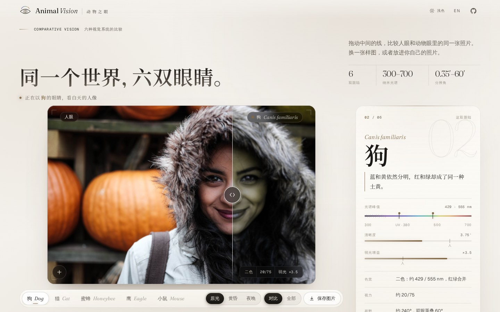
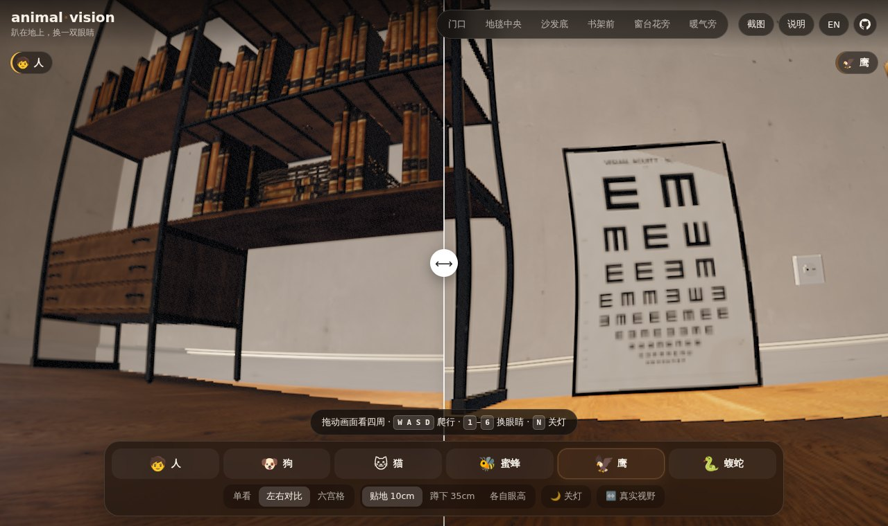
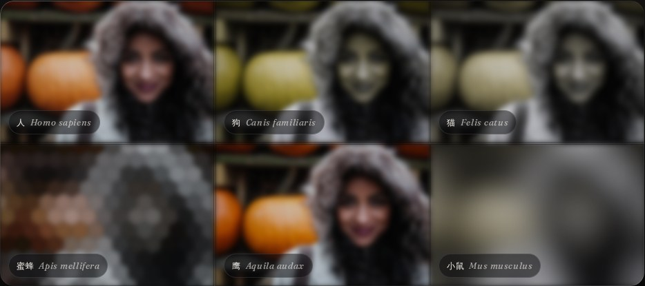

<div align="center">


# 动物之眼 · Animal Vision

**同一个世界，六双眼睛。**

拖动中间的线，看看狗、猫、蜜蜂、鹰和小鼠眼里的世界，和你看到的有什么不同。

**[在线体验 →](https://eyes.loc.cc)** · [English](README.en.md)

</div>


<details>
<summary>浅色主题</summary>



</details>

## 目录

- [能做什么](#能做什么)
- [六双眼睛](#六双眼睛)
- [这些画面是怎么算出来的](#这些画面是怎么算出来的)
- [局限](#局限)
- [使用技巧](#使用技巧)
- [本地运行](#本地运行)
- [项目结构](#项目结构)
- [照片与字体](#照片与字体)

## 能做什么

- **拖动对比**：左边是人眼，右边是动物的眼睛，中间的分割线可以随意拖动，用键盘方向键也可以。
- **六种眼睛**：人、狗、猫、蜜蜂、鹰、小鼠，各自有不同的色觉、清晰度和弱光能力。
- **三种光线**：原光、黄昏、夜晚。光线一暗，人眼先失去颜色，接着被噪点淹没，猫和狗却还看得清。
- **全部视图**：六双眼睛并排看同一张照片。
- **鹰的放大镜**：鹰看得比屏幕能显示的还清楚，所以给它配了一个可以移动的 3 倍放大镜。
- **随手换图**：照片左下角的「＋」可以直接换样图、上传照片，手机上还能直接自拍。
- **用你自己的照片**：可以拖进来、粘贴或点选。照片只在你的浏览器里用 GPU 处理，不会上传。
- **保存图片**：一键导出带标签的对比图。
- **图谱**：用同一把尺子并排比较六种眼睛的视锥峰值、清晰度和弱光增益。点任意一行就能切换到那双眼睛。
- **深色 / 浅色两种主题**：默认是深色，右上角的按钮可以切换到暖色纸感的浅色主题。选择会记在浏览器里，刷新后不变。
- **中文 / English**：页面会按浏览器语言自动选择，也可以随时切换。
- **样图**：6 张 4K 样图，都是 CC0 授权。分别是人像、果园、向日葵、山谷、夜街和猫，每张都标了推荐用哪双眼睛看。默认打开的是人像，看看你在宠物眼里长什么样。

| 狗：红苹果藏进了叶子里 | 蜜蜂：假色和复眼 |
|---|---|
|  |  |
| **猫：夜里的街道** | **鹰：用放大镜看远山** |
|  |  |
| **小鼠：猫成了一团模糊** | **全部：六双眼睛看同一张脸** |
|  |  |

## 六双眼睛

| | 色觉 | 清晰度（最小分辨角） | 弱光增益 | 一句话 |
|---|---|---|---|---|
| 人 *Homo sapiens* | 三色：420 / 530 / 560 nm | 1′（20/20） | 1× | 对照组 |
| 狗 *Canis familiaris* | 二色：429 / 555 nm | 3.75′（约 20/75） | 约 3.5× | 蓝和黄还分得清，红和绿成了同一种土黄 |
| 猫 *Felis catus* | 二色：450 / 555 nm，颜色偏淡 | 约 7′（20/100–20/200） | 约 6× | 白天近视又色弱，天一黑就占了上风 |
| 蜜蜂 *Apis mellifera* | 紫外 344 / 蓝 436 / 绿 544 nm | 每个小眼约 1–2° | 0.8× | 看得见紫外，但世界是一格一格的 |
| 鹰 *Aquila audax* | 四色，视锥里有油滴 | 约 0.35′（约 20/5） | 0.8× | 比人清楚三倍左右 |
| 小鼠 *Mus musculus* | 紫外 360 / 绿 508 nm | 约 60′ | 约 4× | 几乎只能看出明暗和大致轮廓 |

## 这些画面是怎么算出来的

整个过程都用 WebGL2 在浏览器里实时完成：降采样，可分离高斯模糊，颜色模型，光线和噪点，复眼，最后是放大镜。

1. **颜色**：狗和猫用 Machado、Oliveira、Fernandes（2009）的二色视觉模型。小鼠没有长波视锥，用的是红色盲模型。蜜蜂按通行做法用假色显示：绿显示成红，蓝显示成绿，紫外显示成蓝。
2. **清晰度**：在一臂的距离上，一个 CSS 参考像素大约是 1.28 角分，接近人眼的极限。所以这里把一个 CSS 像素当作人眼能分辨的最小细节，其它眼睛按各自的最小分辨角做高斯模糊。鹰比人看得清楚，屏幕表现不出来，所以改用放大镜。
3. **弱光**：调暗光线时，每种眼睛按自己的弱光增益变亮。颜色在暗处先消失，并带一点 Purkinje 偏移，噪点也随之出现。
4. **复眼**：蜜蜂的画面会叠一层六边形的小眼网格。

## 局限

- 照片里没有紫外和温度信息，所以蜜蜂的紫外通道是根据颜色估计出来的。
- 为了看得清，蜜蜂的小眼按真实大小的一半画出。
- 鹰的视锥峰值是近似值。
- 视野、运动感知和大脑的处理都没有画出来。

这里展示的是**有依据的近似**，不是动物真实的主观体验。

## 使用技巧

| 操作 | 方式 |
|---|---|
| 切换眼睛 | 点底部的按钮，或按键盘 `1`–`5` |
| 全部视图 | 点「全部」，或按 `G` |
| 微调分割线 | 选中分割线后按 `←` / `→`，按住 `Shift` 移动得更多 |
| 换图 / 放进你的照片 | 点照片左下角的 `＋`，拖进页面，或用 `Ctrl/⌘ + V` 粘贴 |
| 切换主题 | 右上角的太阳 / 月亮按钮 |

**URL 参数**（可以直接分享当前画面）：

| 参数 | 取值 |
|---|---|
| `img` | `portrait`（默认） `orchard` `sunflower` `valley` `night` `cat` |
| `eye` | `dog` `cat` `bee` `eagle` `mouse` |
| `light` | `day` `dusk` `night` |
| `view` | `grid`（全部视图） |
| `split` | `0`–`1`，分割线的位置 |
| `lang` | `zh` `en` |
| `theme` | `dark`（默认）或 `light` |

例如：`?img=night&eye=cat&light=night&theme=light`

## 本地运行

这是一个纯静态页面，用的是 ES modules 和 WebGL2，不需要构建：

```bash
git clone https://github.com/TTNAN/animal-vision.git
cd animal-vision
python3 -m http.server 8080   # 然后打开 http://localhost:8080
```

需要通过 HTTP 访问，直接双击 `index.html` 打不开 ES modules。

重新生成 README 截图：

```bash
npm i
npx playwright-core install chromium-headless-shell
npm run capture
```

## 项目结构

```
index.html          页面结构，以及首帧前设置主题的小脚本
style.css           全部样式：深色变量在 :root，浅色覆盖在 [data-theme="light"]
src/species.js      六种眼睛的参数、中英文文案、样图信息
src/gl.js           WebGL2 渲染管线
src/app.js          交互、主题、上传、保存、URL 参数
assets/photos/      样图（3840 px）和缩略图
assets/fonts/       自托管字体
assets/logo.svg     Logo；favicon.svg 是简化版
tools/capture.mjs   截图脚本
```

## 照片与字体

样图全部来自 Wikimedia Commons，都是 CC0 公共领域：

[人像](https://commons.wikimedia.org/wiki/File:In_front_of_pumpkin_shelves_(Unsplash).jpg) Frank Marino ·
[果园](https://commons.wikimedia.org/wiki/File:Tree_with_red_apples_in_Barkedal_1.jpg) W.carter ·
[向日葵](https://commons.wikimedia.org/wiki/File:Sunflower_and_bees.jpg) Mustang Joe ·
[山谷](https://commons.wikimedia.org/wiki/File:Wet_mountain_valley_(Unsplash).jpg) Kalen Emsley ·
[夜街](https://commons.wikimedia.org/wiki/File:Night_street_in_Udagawach%C5%8D,_Tokyo_(53335292514).jpg) Romain Guy ·
[猫](https://commons.wikimedia.org/wiki/File:Young_tabby_cat_keeping_watch.jpg) W.carter

字体：Fraunces、Geist、Geist Mono 和思源宋体 Noto Serif SC，都使用 SIL Open Font License。中文字体只保留了页面用到的字，修改中文文案后需要重新生成子集。

之前的 3D 房间版本保留在标签 [`v4-3d`](https://github.com/TTNAN/animal-vision/tree/v4-3d)。

## 许可

代码使用 [MIT License](LICENSE)。
