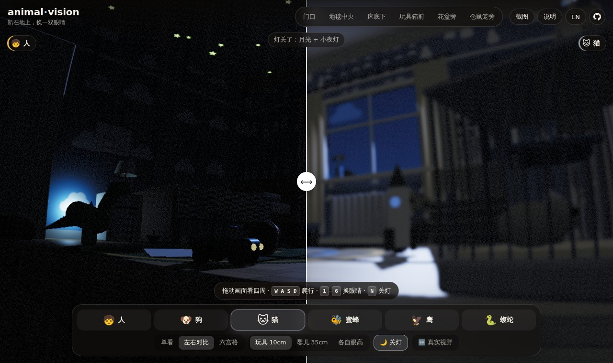

# 动物之眼 · Animal Vision

**同一个世界，六双眼睛。** 拖动中间的线，比较人眼和狗、猫、蜜蜂、鹰、小鼠眼里的同一张照片；也可以放进你自己的照片。

[English](README.en.md) · **在线体验：<https://ttnan.github.io/animal-vision/>**


浅色主题：页眉右侧按钮在「自动 / 浅色 / 深色」之间切换，偏好存在本地；也可以用 `?theme=light` 或 `?theme=dark`。


## 能做什么

- **拖动对比**：左边人眼，右边动物眼，中间的线随意拖。
- **六种眼睛**：人、狗、猫、蜜蜂、鹰、小鼠，各自的色觉、清晰度和弱光能力。
- **光线**：原光 / 黄昏 / 夜晚。光一暗，人眼先丢颜色、再被噪点吞掉，猫和狗却还看得清。
- **全部视图**：六双眼睛并排看同一张照片。
- **你的照片**：拖进来、粘贴或点选。照片只在你的浏览器里用 GPU 处理，不会上传到任何服务器。
- **保存图片**：一键导出带标签的对比图，方便分享。
- **6 张 4K 样图**（CC0）：果园、向日葵、山谷、集市、夜街、猫，每张都配了推荐的眼睛和看点。

| 狗：红苹果藏进叶子 | 蜜蜂：假色 + 复眼 |
|---|---|
|  |  |
| **猫：夜里的街** | **鹰：放大镜看远山** |
|  |  |
| **小鼠：一团模糊的猫** | **全部：六双眼睛** |
|  |  |

## 这些画面是怎么算出来的

| | 色觉 | 清晰度（最小分辨角） | 弱光增益 |
|---|---|---|---|
| 人 | 三色 420 / 530 / 560 nm | 1′（20/20） | 1× |
| 狗 | 二色 429 / 555 nm | 3.75′（约 20/75） | 约 3.5× |
| 猫 | 二色 450 / 555 nm，饱和度低 | 约 7′（20/100–20/200） | 约 6× |
| 蜜蜂 | 紫外 344 / 蓝 436 / 绿 544 nm，假色显示 | 每个小眼约 1–2° | 0.8× |
| 鹰 | 四色，油滴让颜色更饱和 | 约 0.35′（20/5） | 0.8× |
| 小鼠 | 紫外 360 / 绿 508 nm | 约 60′（0.5 周/度） | 约 4× |

- **颜色**：狗、猫用 Machado、Oliveira、Fernandes（2009）的二色模型；小鼠没有长波视锥，用红盲模型；蜜蜂按惯例把 绿→红、蓝→绿、紫外→蓝 显示。
- **清晰度**：CSS 的参考像素在一臂距离下约 1.28 角分，接近人眼极限，所以把一个 CSS 像素当作人眼能分辨的最小细节，其它眼睛按各自的最小分辨角做高斯模糊。鹰比人清楚，屏幕无法表现，所以给了一个 3 倍放大镜。
- **弱光**：每种眼睛按自己的增益变亮；暗处颜色先消失（并带一点 Purkinje 偏移），噪点随之出现。

**局限**：照片没有紫外和温度信息，蜜蜂的紫外通道是按颜色估计的，小眼格子按真实大小的一半画出；没有画视野、运动感知和大脑的处理。这里是有依据的近似，不是动物真实的主观体验。

## 本地运行

不需要构建，纯静态页面（ES modules + WebGL2）：

```bash
python3 -m http.server 8080   # 然后打开 http://localhost:8080
```

重新生成 README 截图：`npm i && npm run capture`（需要 Playwright 的 Chromium）。

## 文件

- `index.html`、`style.css`：页面与样式
- `src/species.js`：六种眼睛的参数、文案（中 / 英）、样图信息
- `src/gl.js`：WebGL2 渲染（降采样 → 可分离高斯 → 颜色模型 / 光线 / 噪点 / 复眼 / 放大镜）
- `src/app.js`：交互、上传、保存、URL 参数
- `assets/photos/`：样图（3840 px）和缩略图

URL 参数：`?img=orchard|sunflower|valley|market|night|cat&eye=dog|cat|bee|eagle|mouse&light=day|dusk|night&view=grid&lang=zh|en`

## 照片

全部来自 Wikimedia Commons，CC0 公共领域：
[果园](https://commons.wikimedia.org/wiki/File:Tree_with_red_apples_in_Barkedal_1.jpg) W.carter ·
[向日葵](https://commons.wikimedia.org/wiki/File:Sunflower_and_bees.jpg) Mustang Joe ·
[山谷](https://commons.wikimedia.org/wiki/File:Wet_mountain_valley_(Unsplash).jpg) Kalen Emsley ·
[集市](https://commons.wikimedia.org/wiki/File:Fruit_market_in_Genoa,_Italy_-_DSC01268.JPG) Daderot ·
[夜街](https://commons.wikimedia.org/wiki/File:Night_street_in_Udagawach%C5%8D,_Tokyo_(53335292514).jpg) Romain Guy ·
[猫](https://commons.wikimedia.org/wiki/File:Young_tabby_cat_keeping_watch.jpg) W.carter

字体：Fraunces、Geist、Geist Mono、思源宋体 Noto Serif SC（SIL Open Font License）。

之前的 3D 房间版本保留在标签 [`v4-3d`](https://github.com/TTNAN/animal-vision/tree/v4-3d)。

MIT License
