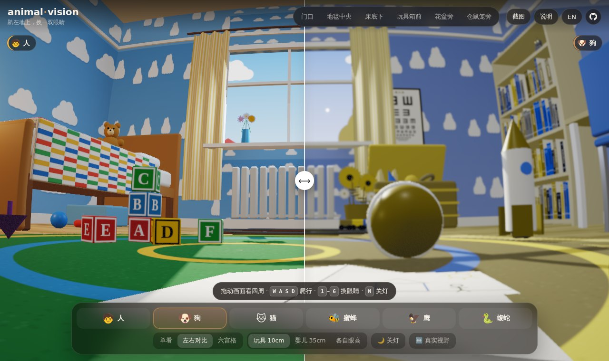
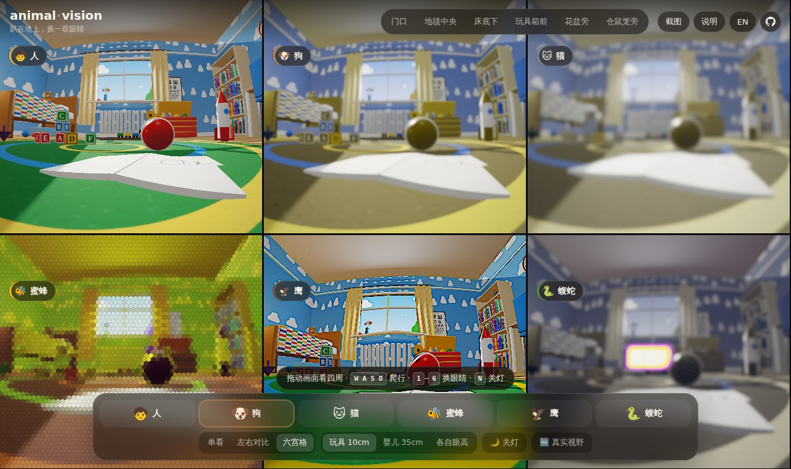
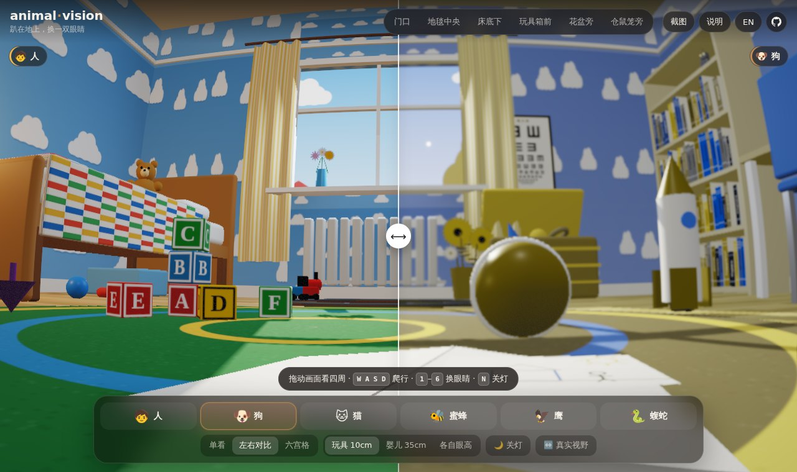
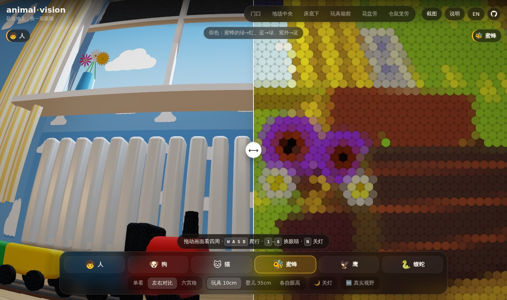
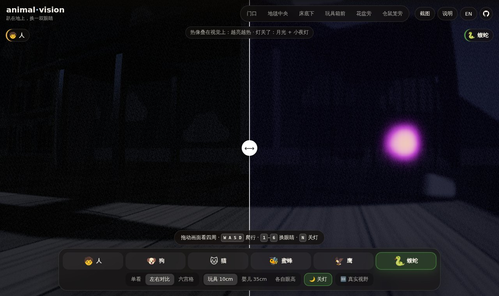

English version: [README.en.md](README.en.md)

# animal-vision · 趴在地上，换一双眼睛

一间 3D 儿童房，镜头放在地板上，玩具的高度。像《玩具总动员》里的玩具那样，抬头看床、看地毯上的红球、看窗台上的向日葵。然后换一双眼睛：狗、猫、蜜蜂、鹰、蝮蛇。



## 打开就能玩

```bash
git clone https://github.com/TTNAN/animal-vision.git
```

双击 `index.html`。已经打包好的 `dist/app.js` 在仓库里，不用装任何东西，离线也能看。也可以在仓库 Settings → Pages 里从 `main` 部署，地址一般是 `https://TTNAN.github.io/animal-vision/`。

| 操作 | 电脑 | 手机 |
| --- | --- | --- |
| 环顾四周 | 拖动画面 | 单指拖动 |
| 在地上爬 | W A S D / 方向键 | 左下角方向键 |
| 换眼睛 | 1–6，或底部按钮 | 底部按钮 |
| 关灯 | N | “关灯”按钮 |
| 截图 | “截图”按钮 | 同左 |

## 六个小任务

页面里的“说明”面板有这几个任务，一键直达：

1. 🔴 **红球去哪了？** 狗眼里，绿地毯上的红球只剩明暗差别，红色和绿色积木也分不开了。
2. 🌻 **向日葵的紫外线靶心**。蜜蜂眼里，花瓣外圈亮、里圈暗，像给传粉者画的跑道。
3. 👁 **谁能看清视力表最后一行？** 六宫格同时看，鹰的中央凹像一个长焦镜头。
4. 🐹 **关着灯，找到仓鼠**。人眼一片黑，蝮蛇的颊窝把仓鼠、热可可和暖气片“看”成发亮的热源。
5. 🌙 **关灯以后，猫看到了什么**。人眼几乎全黑，猫还能看清房间的轮廓。
6. ↔️ **视野能有多宽？** 打开“真实视野”，蜜蜂和狗的画面会一下子变宽。

还有“从床底下往外看”：把高度切到“各自眼高”，猫钻进床底的视角。



| 狗 · 地毯 | 猫 · 关灯 |
| --- | --- |
|  |  |
| **蜜蜂 · 花盆旁** | **蝮蛇 · 关灯找仓鼠** |
|  |  |

## 六种眼睛

| 眼睛 | 颜色 | 清晰度 | 视野 | 夜里 |
| --- | --- | --- | --- | --- |
| 人 | 三色，约 420 / 530 / 560 nm | 20/20，参照 | 约 200° | 参照 |
| 狗 | 二色，约 429 / 555 nm，红绿合一 | 约 20/75 | 约 240–250° | 反光层，好于人 |
| 猫 | 二色，约 450 / 555 nm，颜色淡 | 约 20/100–20/200 | 约 200° | 约人类 1/6 的光就够 |
| 蜜蜂 | 紫外 / 蓝 / 绿，看不到红；假色显示 | 复眼每个“像素”约 1.5–2° | 接近 360° | 很差 |
| 鹰 | 四色，油滴让颜色更饱和 | 约 20/5，中央凹放大 | 200° 以上 | 不如人 |
| 蝮蛇 | 二色眼睛 + 颊窝热像 | 热像模糊 | 约 170°（示意） | 热像不需要光 |

## 房间里为什么放这些东西

每件东西都为了让某一种差别露出来：

- **绿地毯上的红球、红绿积木**：测红绿之分。
- **窗台上的向日葵和花**：带一张紫外线贴图，只有蜜蜂看得到靶心。
- **玩具箱上的视力表**、书架上的书脊：测清晰度。
- **仓鼠笼、热可可、暖气片、台灯、窗玻璃**：每个物体都有温度，给蝮蛇的热像用。
- **床底、玩具箱、门口、地毯中央、花盆旁、仓鼠笼旁**：六个机位，都是玩具会待的地方。
- 衣柜、书桌、床头柜、火车轨道（小火车在跑）、吊扇、夜光星星、火箭、恐龙：让它先像一个真实的孩子房间，对比才有意义。

## 科学说明：这不是什么

这是**近似模拟**。屏幕不能让你体验另一种动物的主观感受，能做的是把发表过的测量结果翻译成人眼看得懂的画面。

- **二色视觉**（狗、猫、蝮蛇的眼睛）在线性光里用二色模拟矩阵换算，按各自视锥峰值调整，保持亮度。
- **清晰度**按视力换算成每种动物的模糊半径；鹰做锐化，并在画面中心放大，模拟深中央凹。
- **紫外线屏幕显示不出来。** 场景里的紫外线信息是单独画的一张贴图（花瓣靶心是这类图案的常见形态，不是测量数据），蜜蜂的画面用**假色**显示：绿→红、蓝→绿、紫外→蓝。
- **蜜蜂的六边形马赛克**表示复眼的分辨率量级，真实的小眼排列并不是规则的格子。
- **热像**按每个物体设定的温度渲染，再模糊处理；蝮蛇的视野和分辨率随种类差别很大，这里是示意。
- **超宽视野**在平面屏幕上只能压缩显示，“真实视野”最多显示到约 230°，再宽会变成“小星球”式的扭曲。
- 夜间模式里弱光的颜色消失、噪点和增益是示意，不是逐种测量的感光曲线。

如果你发现哪里和文献对不上，欢迎提 issue，附上来源更好。

## 改代码

```bash
npm install
npm run dev      # 监听改动并在本地起服务
npm run build    # 生成 dist/app.js
npm run capture  # 重新生成 assets/ 里的截图（需要 Chrome）
```

```text
animal-vision/
├── index.html          # 页面骨架，中文优先，右上角切 EN
├── style.css
├── dist/app.js         # 打包好的代码（直接打开 index.html 用的就是它）
├── src/
│   ├── main.js         # 渲染、移动、碰撞、分屏、任务、URL 参数
│   ├── room.js         # 房间、家具、玩具、灯光、机位、动画
│   ├── textures.js     # 程序生成的贴图（墙纸、地板、视力表、紫外线花瓣……）
│   ├── vision.js       # 六种眼睛的参数和着色器
│   └── i18n.js         # 中英文文案和任务
├── tools/capture.mjs   # 截图脚本
└── assets/             # README 和分享卡片用的截图
```

**怎么画出来的**：每帧用立方体相机在眼睛的位置拍一圈（正常颜色一张，紫外线一张，温度一张），再由着色器按每种动物的视野投影、模糊、换色、加马赛克或热像。所以同一个位置可以同时给六种眼睛看，分屏和六宫格看到的是同一瞬间。

**分享某个画面**：URL 参数可以直接定位，例如 `index.html?sp=bee&view=flower&mode=split`。参数有 `sp`（human/dog/cat/bee/eagle/snake）、`view`（door/rug/bed/chest/flower/hamster）、`mode`（single/split/grid）、`h`（toy/baby/own）、`night=1`、`fov=1`、`lang=en`。

## 版本

- **v2**：3D 儿童房、玩具视角、六种眼睛（新增蝮蛇热像）、分屏和六宫格、关灯、真实视野、六个任务、六个机位。
- **v1**：一张 AI 生成的客厅照片加五种滤镜，见 tag `v1`。

MIT License
